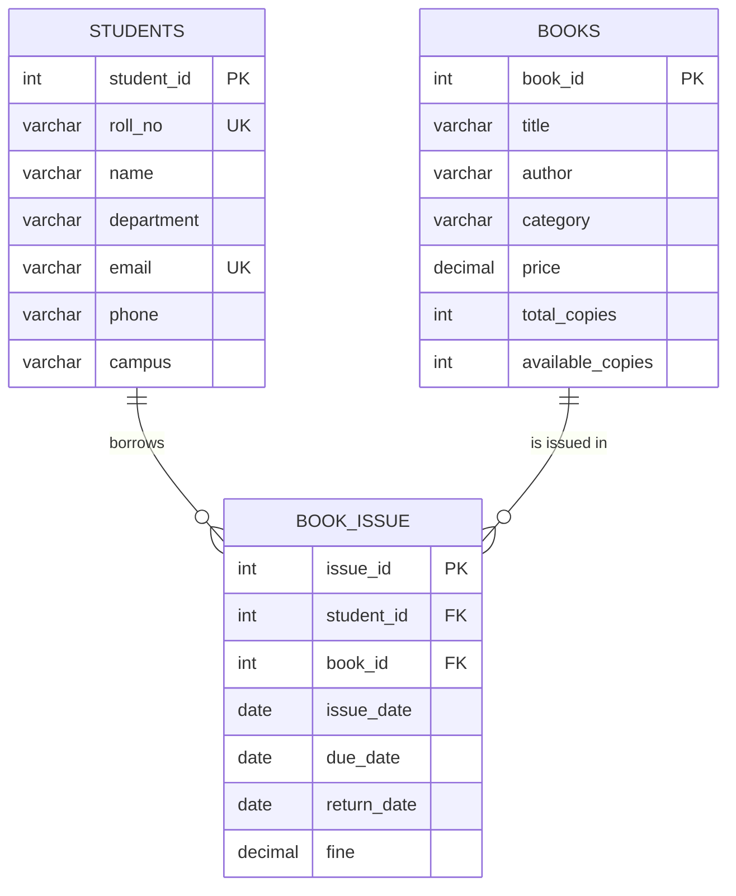

# 📚 Library Management System

### DBMS Mini Project using SQL (MySQL / MariaDB)

---

## 👤 Student Details

| | |
|---|---|
| **Project Title** | DBMS Mini Project – Library Management System |
| **Name** | Aditya Kumar |
| **Roll Number** | 2419158 |
| **Branch / Section** | CSE – A |
| **Course** | Database Management Systems (DBMS) |
| **Assessment Method** | Mini Project (Individual) |

---

## 📖 Project Overview
The **Library Management System** is a relational database project that manages **student information, books, book issue records and book return records**. It demonstrates database design, primary and foreign keys, constraints, joins, aggregate functions and basic data manipulation (INSERT, UPDATE, DELETE) using SQL.

## 🎯 Objectives
- Create a database named `LibraryDB` with the tables **Students**, **Books** and **Book_Issue**.
- Insert at least 5 student records and 10 book records.
- Display available books and student details.
- Display books issued to a particular student.
- Explain how the database can be connected to a website.
- Explain how a distributed database can support libraries at different campuses.

## ✨ Features
- Student management with unique roll number and email
- Book catalogue with category, price and copy tracking
- Issue and return tracking in a single table (`return_date IS NULL` means not yet returned)
- Automatic data validation using `PRIMARY KEY`, `FOREIGN KEY`, `UNIQUE`, `NOT NULL`, `CHECK` and `DEFAULT`
- Fine tracking for late returns
- Reports using joins, aggregate functions, `GROUP BY` and `HAVING`

## 🛠 Tech Stack
| Component | Technology |
|---|---|
| Database | MySQL 8 / MariaDB |
| Language | SQL (DDL, DML, DQL) |
| Tools | MySQL Workbench / Terminal, Git, GitHub |

---

## 🗄 Database Design

### Entity Relationship Diagram

### Tables
**Students**
| Column | Type | Constraint |
|---|---|---|
| student_id | INT | PRIMARY KEY, AUTO_INCREMENT |
| roll_no | VARCHAR(15) | NOT NULL, UNIQUE |
| name | VARCHAR(50) | NOT NULL |
| department | VARCHAR(30) | NOT NULL |
| email | VARCHAR(60) | UNIQUE |
| phone | VARCHAR(15) | |
| campus | VARCHAR(30) | DEFAULT 'Main Campus' |

**Books**
| Column | Type | Constraint |
|---|---|---|
| book_id | INT | PRIMARY KEY, AUTO_INCREMENT |
| title | VARCHAR(100) | NOT NULL |
| author | VARCHAR(60) | NOT NULL |
| category | VARCHAR(30) | NOT NULL |
| price | DECIMAL(8,2) | CHECK (price > 0) |
| total_copies | INT | NOT NULL, CHECK (>= 0) |
| available_copies | INT | NOT NULL, CHECK (>= 0 and <= total_copies) |

**Book_Issue**
| Column | Type | Constraint |
|---|---|---|
| issue_id | INT | PRIMARY KEY, AUTO_INCREMENT |
| student_id | INT | FOREIGN KEY → Students(student_id), ON DELETE CASCADE |
| book_id | INT | FOREIGN KEY → Books(book_id), ON DELETE CASCADE |
| issue_date | DATE | NOT NULL |
| due_date | DATE | NOT NULL, CHECK (due_date >= issue_date) |
| return_date | DATE | NULL until the book is returned |
| fine | DECIMAL(6,2) | DEFAULT 0 |

> A student can borrow many books and a book can be borrowed by many students. `Book_Issue` resolves this **many-to-many** relationship.

---

## 🧠 Database Concepts Used
| Concept | Where it is used |
|---|---|
| **Primary Key** | `student_id`, `book_id`, `issue_id` uniquely identify rows |
| **Foreign Key** | `Book_Issue` references `Students` and `Books` (referential integrity) |
| **ON DELETE CASCADE** | Deleting a student or book removes related issue records |
| **UNIQUE** | `roll_no` and `email` cannot repeat |
| **NOT NULL / DEFAULT** | Mandatory fields and default values (campus, fine) |
| **CHECK** | `price > 0`, `available_copies <= total_copies`, `due_date >= issue_date` |
| **INNER JOIN / LEFT JOIN** | Combining Students, Books and Book_Issue |
| **Aggregate functions** | `COUNT`, `SUM`, `AVG`, `MAX` |
| **GROUP BY / HAVING** | Grouped reports (books per student, category counts) |
| **DML** | `INSERT`, `UPDATE`, `DELETE` for issuing and returning books |

---

## ✅ Conclusion
This project implements a normalized library database with enforced data integrity and demonstrates core SQL features (DDL, DML, joins, aggregates).

---

**Aditya Kumar** | Roll No. **2419158** | CSE – A
*DBMS Mini Project – Library Management System*

